# BoardMD

A lightweight Jira-style backlog, sprints and board for [Obsidian](https://obsidian.md). Every issue and every sprint is a plain note, so your project data is just Markdown you own: searchable, linkable, and easy for people and AI agents to read and edit.

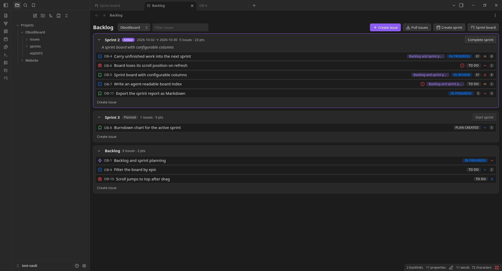

## Features

- **Backlog and sprints.** Plan issues into sprints, drag to re-rank, start and complete sprints. Completing a sprint records what was finished and carries unfinished work over.
- **Sprint board.** One column per status in your workflow, with drag-and-drop between columns.
- **Configurable workflow.** Define your own statuses (for example *To Do / Blocked / Plan Created / In Progress / In Review / Done*) and say whether each counts as to do, in progress or done.
- **Several projects.** Each project is a folder with its own issues, sprints, key prefix, sprint length and workflow, switched from a dropdown on the board.
- **Issues are notes.** Fields are properties, links to other issues are real links, the description is the note body.
- **Links between issues.** Parent, blocks, is blocked by, relates to, duplicates, is duplicated by. Both sides are always written, and blocked issues are flagged on the board.
- **Pull from GitHub or GitLab.** Link a project to a repository and pull its issues into the project's `issues` folder.
- **Made for AI agents.** The plugin keeps an `index.json` and an `AGENTS.md` in each project folder, so an agent can answer "what did Sprint 3 complete?" or "what blocks OB-7?" without parsing every note.

## Install

BoardMD is not listed in the community plugin directory yet. Once it is, install it from **Settings → Community plugins → Browse** by searching for "BoardMD".

Until then, download `main.js`, `manifest.json` and `styles.css` from the [latest release](https://github.com/ericfisherdev/boardmd/releases/latest), or build them from source:

```bash
git clone https://github.com/ericfisherdev/boardmd.git
cd boardmd
npm install
npm run build
```

Then copy `main.js`, `manifest.json` and `styles.css` into `<your vault>/.obsidian/plugins/boardmd/`, and enable **BoardMD** under Settings → Community plugins.

Requires Obsidian **1.13.0 or later** (the settings use Obsidian's declarative settings, so they show up in settings search). It has only been tried on desktop.

## Walkthrough

The screenshots below come from a sandbox vault with two projects, **Obsidiboard** and **Website**.

### 1. Plan in the backlog


The backlog lists the active sprint, planned sprints and the backlog, in rank order. Each row shows the type, key, summary, a warning when unfinished issues block it, its parent epic, status, assignee, priority and story points. Drag rows to re-rank them or move them between sprints. **Start sprint** and **Complete sprint** sit in each sprint's header.

The toolbar has the project switcher, a filter box, and buttons to create an issue, pull issues from a linked repository, create a sprint and open the sprint board.

### 2. Work the sprint board

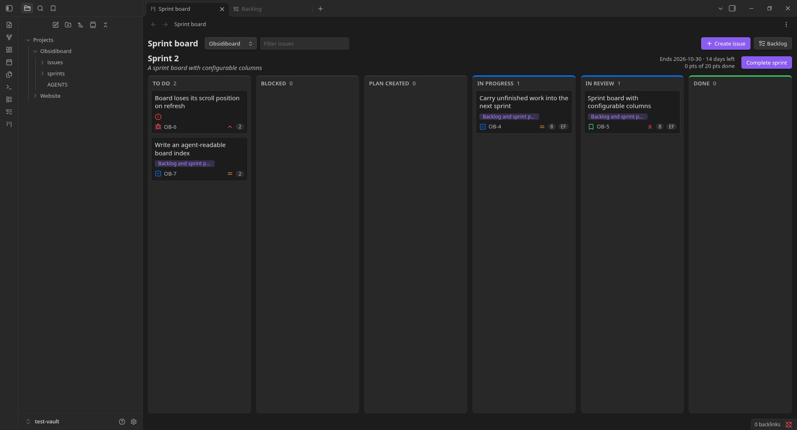

The board shows the active sprint with one column per status in the project's workflow. The header shows the end date, days left and points done.

### 3. Create an issue

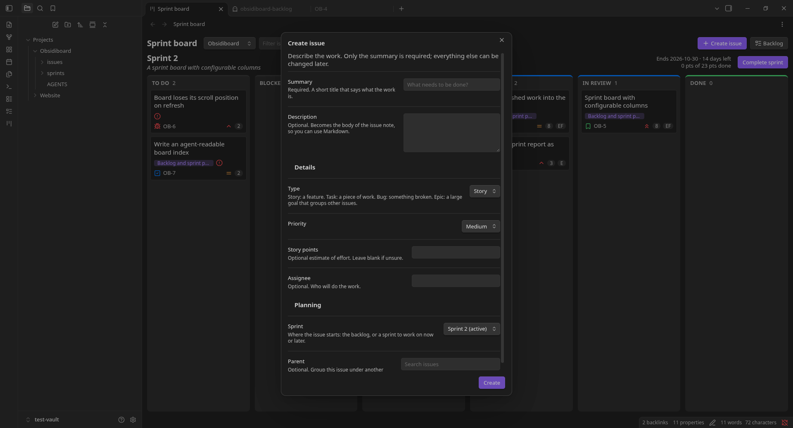

**Create issue** opens a form that starts with the work itself (summary, description), then optional details (type, priority, story points, assignee), then planning (sprint and parent). Only the summary is required, and the **Create** button stays greyed out until it has text. Opened from the board, the sprint defaults to the active sprint.

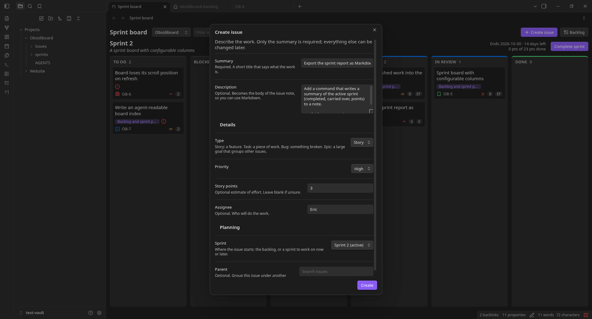

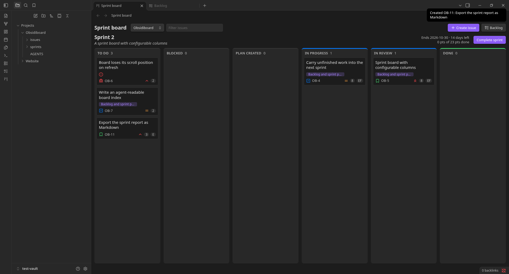

After you create it, a notice shows the new key and the card appears in the first column.

### 4. Move cards between columns


Drag a card to another column or to a different position in a column. A line shows where it will land.


Dropping changes the issue's status and writes it to the note straight away. Moving a card into a Done status also records the date it was resolved.

### 5. Edit an issue

Click a card to open its edit form. Ctrl or Cmd-click opens the issue's note in a new tab instead. Issue notes also get an **Edit issue** button in the header and an **Edit issue** command.

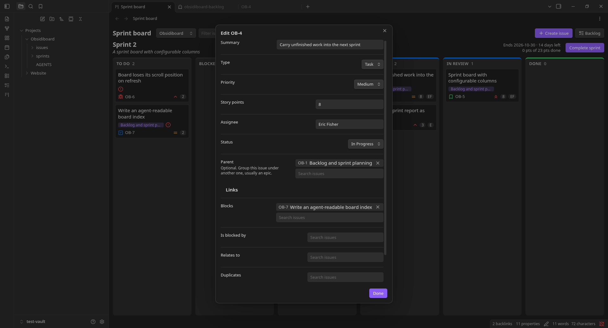

Type, priority and status are dropdowns, and the parent is chosen from existing issues.

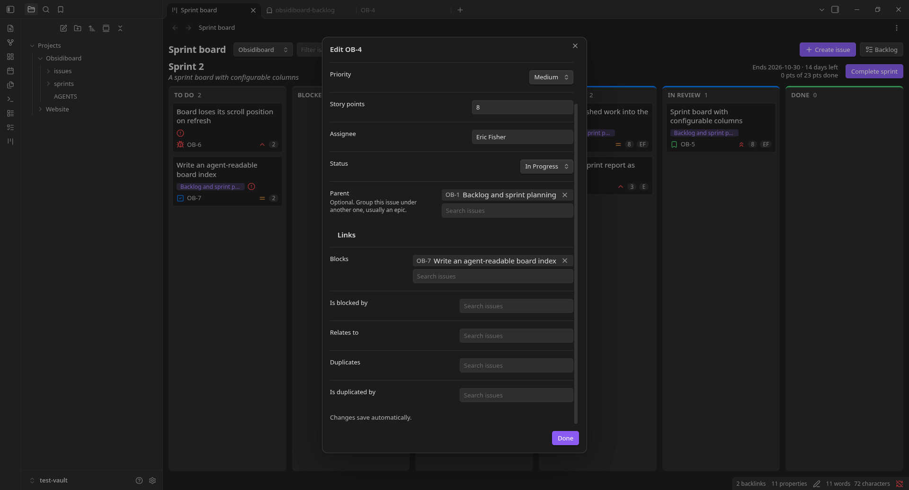

Links to other issues are chosen the same way. Changes save by themselves a moment after you stop typing, and the form says so at the bottom. **Done** saves anything pending and closes it.

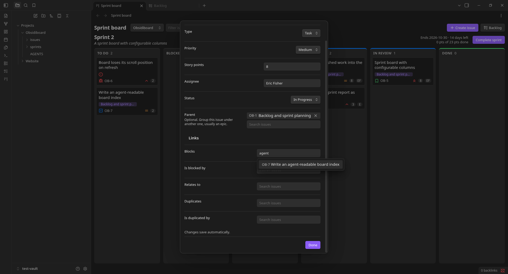

Each picker suggests existing issues by key or summary as you type.

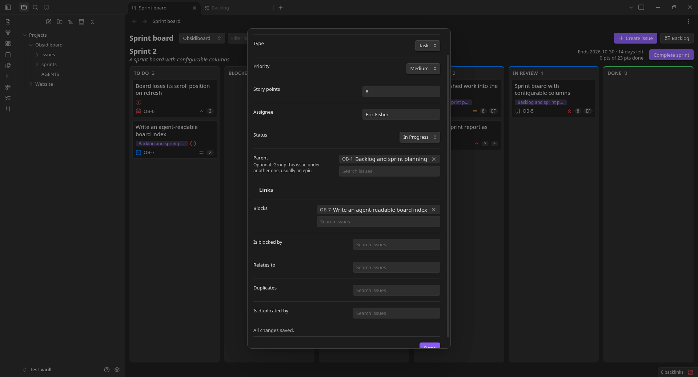

Adding a link writes both sides: OB-4 now lists OB-7 under `blocks`, and OB-7 lists OB-4 under `blocked_by`.


An issue that is blocked by unfinished work gets a red warning icon on its card.

### 6. Several projects

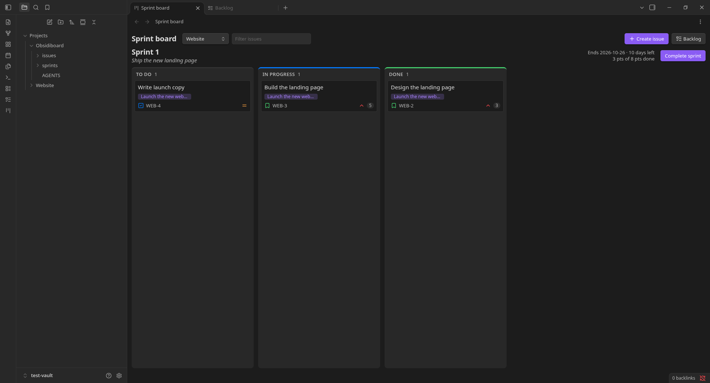

The dropdown next to the title switches projects. The Website project has its own sprint, issues and a three-column workflow (To Do, In Progress, Done), while Obsidiboard has six columns. Each project also has its own issue key prefix (`OB-`, `WEB-`) and default sprint length.

### 7. Settings

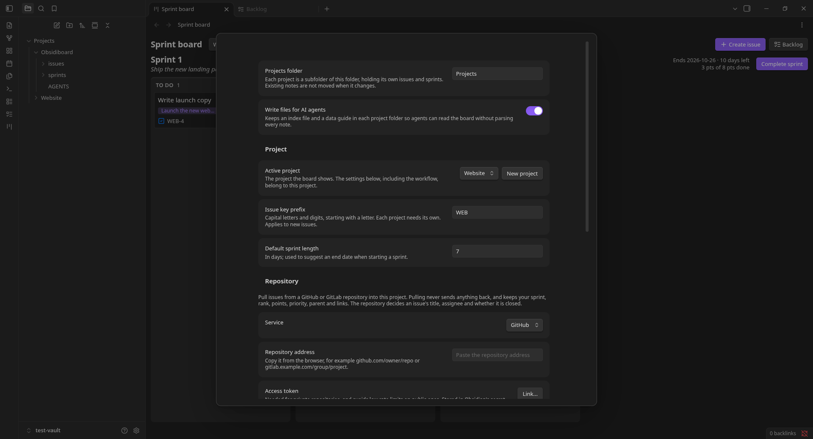

The settings tab holds the projects folder, the switch for the generated AI-agent files, and the active project's key prefix and default sprint length.

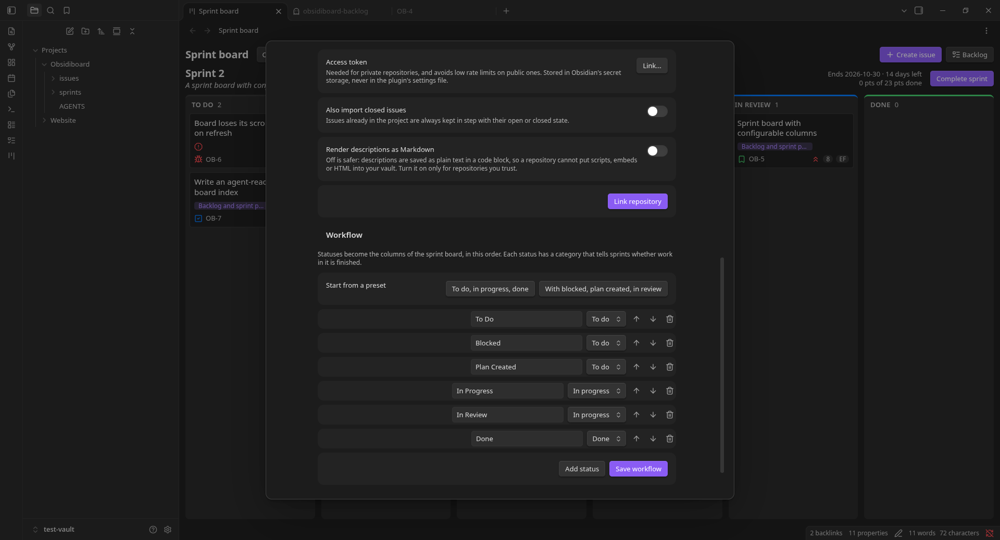

Each project can be linked to a GitHub or GitLab repository, with the access token kept in Obsidian's secret storage. The same page edits the project's workflow: statuses, their order, and whether each counts as to do, in progress or done.

### 8. It is all plain notes

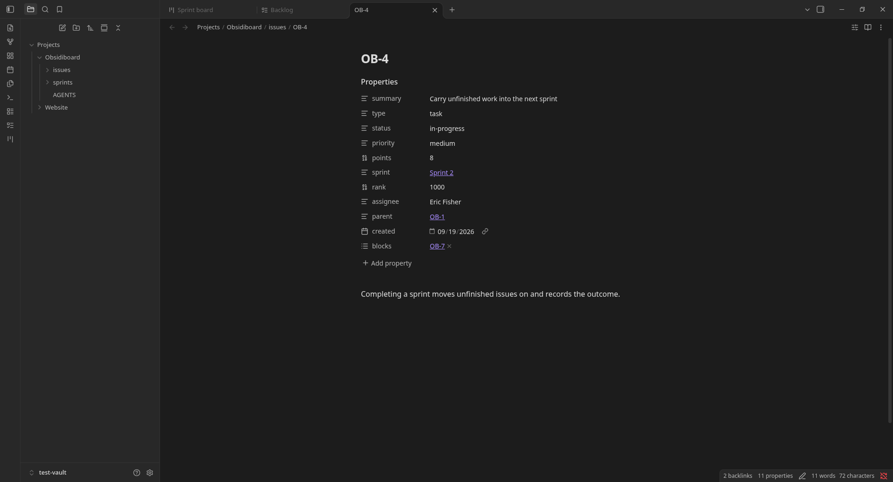

Each issue is a normal note. Its fields are properties, links to other issues are links, and its description is the note body.

## How the data is stored

```
Projects/                      ← the projects folder (a setting)
  Obsidiboard/                 ← one folder per project
    issues/OB-1.md … OB-11.md
    sprints/Sprint 1.md …
    index.json                 ← generated, for AI agents
    AGENTS.md                  ← generated guide to the data
  Website/
    issues/WEB-1.md …
    sprints/Sprint 1.md …
```

An issue note:

```markdown
---
summary: Carry unfinished work into the next sprint
type: task
status: in-progress
priority: medium
points: 8
sprint: "[[Projects/Obsidiboard/sprints/Sprint 2|Sprint 2]]"
rank: 1000
assignee: Eric Fisher
parent: "[[OB-1]]"
created: 2026-09-19
blocks:
  - "[[OB-7]]"
---
Completing a sprint moves unfinished issues on and records the outcome.
```

A sprint note keeps its state, dates, goal and, once completed, what it finished:

```markdown
---
state: closed
sequence: 1
start_date: 2026-09-18
end_date: 2026-10-01
goal: "Plan work into sprints"
committed_points: 16
completed_points: 8
completed_issues:
  - "[[OB-2]]"
  - "[[OB-3]]"
carried_over_issues:
  - "[[OB-4]]"
---
```

Things worth knowing:

- Issue keys are the file names (`OB-12.md`). Each project needs its own key prefix, so links like `[[OB-1]]` are never ambiguous.
- Sprint links include the sprints folder, because every project has sprints with the same names.
- Edit notes by hand if you like. Link fields come in pairs (`blocks` ↔ `blocked_by`, `duplicates` ↔ `duplicated_by`); when one note names the other the plugin treats both as linked.
- `index.json` and `AGENTS.md` are regenerated while Obsidian is open. The notes are the source of truth.

## Pulling issues from GitHub or GitLab

In Settings → BoardMD → Repository, choose the service, paste the repository address, optionally pick an access token, and press **Link repository**. Then run **Pull issues** from the backlog toolbar, the command palette, or the settings page.

- New repository issues become backlog issues, with a `source` property holding the issue's web address.
- Later pulls keep **title, assignee and open/closed state** in step with the repository. Your sprint, rank, points, priority, parent, links and description are never overwritten.
- Open issues are pulled by default. Turn on **Also import closed issues** for the rest. Issues already in the project are always kept in step with their state.
- Descriptions are saved as plain text in a code block, so a repository cannot put scripts, embeds or HTML into your vault. Turn on **Render descriptions as Markdown** only for repositories you trust.
- Pulling is one way: nothing is sent back to the repository.
- Access tokens live in Obsidian's secret storage, never in the plugin's settings file. Public repositories work without one but have low rate limits.

## Commands

| Command | What it does |
| --- | --- |
| Open backlog | Opens the backlog view |
| Open sprint board | Opens the sprint board |
| Create issue | Opens the create form |
| Create sprint | Adds a planned sprint |
| Switch project | Picks the project the board shows |
| Create project | Adds a project folder with its own settings |
| Pull issues from linked repository | Pulls issues for the active project |
| Edit issue | Edits the issue note you have open |

## Not built yet

- Deleting issues from the board
- Burndown charts
- Filtering the board by epic
- Pushing changes back to GitHub or GitLab, and importing comments or labels as fields

## Development

```bash
npm install
npm run dev        # rebuild main.js on change
npm run build      # typecheck, then a production build
npm test           # vitest
npm run lint       # eslint with the Obsidian plugin rules
```

The code is layered: `src/domain` (pure rules), `src/application` (commands and queries over ports), `src/infrastructure` (the vault, frontmatter, agent files, GitHub and GitLab), `src/settings` and `src/ui`, wired together in `src/compose.ts`. Dependencies are passed in through constructors.

To try the plugin, make a throwaway vault, link `main.js`, `manifest.json` and `styles.css` into its `.obsidian/plugins/boardmd/` folder, and reload the plugin after each build.

## License

[MIT](LICENSE) © 2026 Eric Fisher
